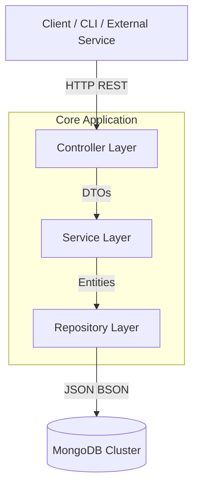

# Log Ingestor & Query Interface

This project provides a robust solution for ingesting high volumes of log data and offering an efficient, user-friendly interface for querying that data. It is architected to handle scalable ingestion demands while ensuring fast retrieval times for analysis and debugging.

The system is built using **Spring Boot** and **MongoDB**, ensuring a modern, reactive, and non-blocking foundation where applicable. It supports both programmatic access via REST APIs and manual interaction via a command-line interface.

---

## 🏗 Architecture

The application follows a standard layered architecture, promoting separation of concerns and maintainability.



-   **Controller Layer**: Acts as the entry point for HTTP requests, handling route mapping, input validation, and HTTP response codes.
-   **Service Layer**: Encapsulates business logic, including data transformation (DTO to Entity) and complex query construction.
-   **Repository Layer**: Interfaces with the MongoDB database using `MongoTemplate` for dynamic queries and `MongoRepository` for standard operations.

---

## 🚀 Technology Stack

-   **Language**: Java 17+
-   **Framework**: Spring Boot 3.x
-   **Database**: MongoDB
-   **Build Tool**: Maven
-   **Testing**: JUnit 5, MockMvc, Embedded MongoDB

---

## ✨ Features

1.  **Log Ingestion**: A streamlined API endpoint designed to accept log entries with high throughput.
2.  **Advanced Filtering**: Users can filter logs based on multiple criteria:
    -   Log Level (`level`)
    -   Message content (`message` - supports regex)
    -   Resource Identifier (`resourceId`)
    -   Timestamp (`timestamp`)
    -   Trace & Span IDs (`traceId`, `spanId`)
    -   Commit Hash (`commit`)
    -   Metadata (`metadata.parentResourceId`)
    -   **Date Ranges**: Accurate filtering between start and end timestamps.
3.  **Dual Interfaces**:
    -   **REST API**: For integration with other services or dashboards.
    -   **CLI**: A built-in console query interface for quick, local debugging.
4.  **Resilience**: Comprehensive exception handling ensures reliability and clear feedback.

---

## 🛠️ Getting Started

### Prerequisites

-   Java 17 or higher
-   Maven
-   MongoDB (running locally on port `27017` or configured via properties)

### Installation

1.  **Clone the repository**
    ```bash
    git clone https://github.com/dheeraj2897/log_ingestor_and_query_interface.git
    cd logingestor
    ```

2.  **Configuration**
    Update `src/main/resources/application-dev.properties` with appropriate MongoDB connection details if necessary.

3.  **Run the Application**
    ```bash
    ./mvnw spring-boot:run -Dspring.profiles.active=dev
    ```
    The server will start on port **3000** by default.

### Running Tests

The project includes an integration test suite that utilizes **embedded MongoDB**, eliminating the need for a separate database instance during testing.

```bash
./mvnw clean test
```

---

## 📡 API Reference

### 1. Ingest Log Data

**Endpoint**: `POST /v1/api/logs/saveLogData`
**Content-Type**: `application/json`

**Sample Payload**:
```json
{
	"level": "error",
	"message": "Failed to connect to DB",
	"resourceId": "server-1234",
	"timestamp": "2023-09-15T08:00:00Z",
	"traceId": "abc-xyz-123",
	"spanId": "span-456",
	"commit": "5e5342f",
	"metadata": {
		"parentResourceId": "server-0987"
	}
}
```

### 2. Search Logs

**Endpoint**: `POST /v1/api/logs/searchByCriteria`
**Content-Type**: `application/json`

**Sample Payload** (All fields optional):
```json
{
  "level": "error",
  "message": "Failed",
  "fromDate": "2023-09-14T00:00:00",
  "toDate": "2023-09-16T00:00:00"
}
```

### 3. Retrieve All Logs

**Endpoint**: `GET /v1/api/logs`

---

## 🖥️ Interactive CLI

The application creates an interactive command-line session upon startup (when not in the test profile). This serves as a convenient tool for developers to query logs directly from the terminal.

```text
Menu:
1. Search logs
2. Exit
Choose an option: 
```

Users can follow the prompts to input search parameters dynamically.
